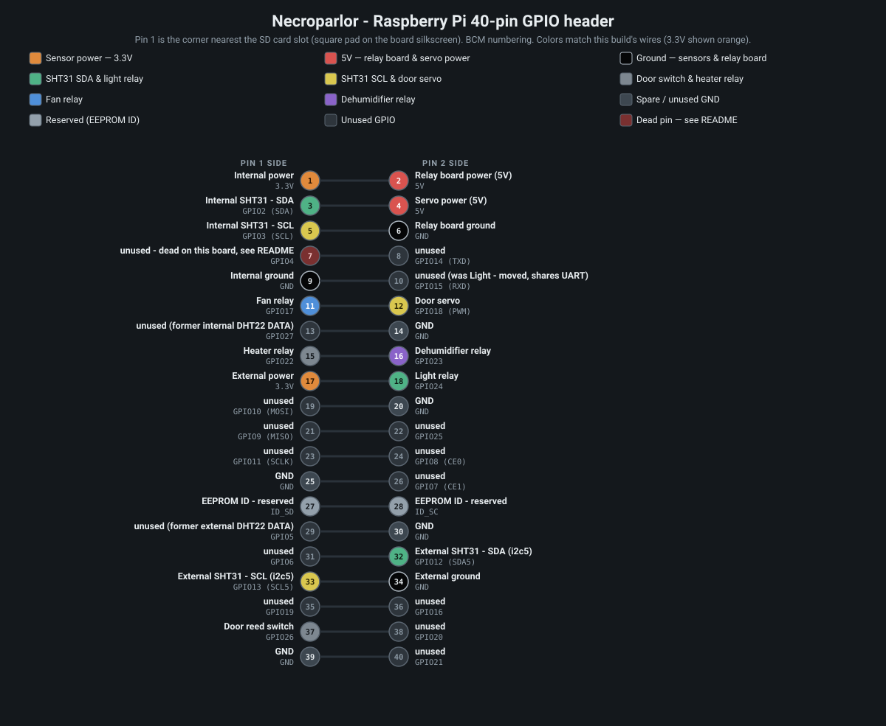

# Necroparlor

Raspberry Pi climate control for a dermestid beetle colony living in a converted chest freezer: temperature/humidity monitoring, heater/fan/dehumidifier control, a door-open safety light, an optional webcam, and a web dashboard.

**Starting a new session on this project? Read `PROJECT_STATUS.md` first** — it covers current state, the reasoning behind non-obvious design decisions, and open threads this README won't get into.

## Files

| File | Purpose |
|---|---|
| `climate.py` | Main control loop — heater, fan/vent servo, dehumidifier, door light. Always running. |
| `webapp.py` | Flask dashboard — live readings/history, mode switching, setpoints. |
| `shared_state.py` | Shared config + SQLite helpers used by every other script, including notification dispatch. Must live in the same folder. |
| `templates/` | Dashboard pages: `base.html` (nav/layout, shared confirm dialog), `home.html`, `timelapse.html`, `logs.html` (Events), `data.html`, `config.html` (Setpoints), `settings.html` (Sensors), `camera.html`, `notifications.html`, `system.html`. |
| `static/` | Home-screen icon and the fan badge icon. |
| `config.json` | Current mode, setpoints, sensor/camera/notification settings. Not git-tracked; auto-created if missing. |
| `ble_listener.py` | Optional — listens for a BLE temp/humidity sensor (SensorPush, Govee, INKBIRD, Xiaomi, RuuviTag) as the external reading. |
| `ble_battery.py` | Optional — periodic battery check (SensorPush HT1 only; other brands broadcast battery for free). |
| `discover_ble_sensor.py` | One-time helper to find a BLE sensor's address. |
| `camera_service.py` | Optional — timelapse capture for the running recording only (pulls snapshots from camera-streamer's HTTP API). Live view itself is served by camera-streamer, a separate daemon — see `docs/camera-streamer-setup.md`. |
| `discover_camera.py` | One-time helper to find the webcam's `/dev/videoN` index. |
| `timelapse_encode.py` | The one ffmpeg encode used for every timelapse video and preview (timestamp overlay, timeout, truncation check), plus `compile_recording()`. |
| `compile_timelapse.py` | Compiles a stopped timelapse recording over SSH, with no time limit. |
| `auto_update.sh` | Pulls from git and restarts the affected services. |
| `systemd/` | Unit/timer files so everything runs on boot and restarts on crash. |
| `docs/` | camera-streamer setup guide and the GPIO pinout diagram (plus the script that generates it). |

## Hardware / wiring



Diagram colors match the actual jumper wires in this build (see the in-image legend) — not a generic category scheme.

GPIO pin assignments (BCM numbering, set in `climate.py`):

| Function | BCM | Physical pin |
|---|---|---|
| Fan relay | GPIO17 | 11 |
| Door servo (PWM) | GPIO18 | 12 |
| Heater relay | GPIO22 | 15 |
| Dehumidifier relay | GPIO23 | 16 |
| Light relay | GPIO24 | 18 |
| Door reed switch | GPIO26 | 37 (its other lead on GND, pin 39) |
| Internal SHT31 SDA | GPIO2 | 3 |
| Internal SHT31 SCL | GPIO3 | 5 |
| External/fallback SHT31 SDA (i2c5) | GPIO12 | 32 |
| External/fallback SHT31 SCL (i2c5) | GPIO13 | 33 |

All four relay inputs sit together on physical pins 11/15/16/18, and the reed switch's two leads land on adjacent pins 37 + 39. **Wire to this layout before running `climate.py`** — the light pin is driven HIGH as an output at startup, so a reed switch left on it would short that pin to ground whenever the switch is closed.

**GPIO4 (physical pin 7)** is not used: it read stuck-low on this build (via `pinctrl`), most likely because of the Argon ONE case's pass-through riser rather than the Pi itself — never re-tested outside the case (see `PROJECT_STATUS.md`). **GPIO15/RXD** is avoided for the same reason it's marked unused above — it doubles as UART0 RXD and misbehaves if the serial console is enabled. GPIO27 and GPIO5 (physical pins 13/29) are free/unused — the old wired DHT22 probes that lived there have been retired in favor of two SHT31s (see "Sensors" below and `PROJECT_STATUS.md`).

If `PIN_*` in `climate.py` ever changes again, regenerate the diagram with `python3 docs/gen_gpio_pinout.py` after updating its `ROWS` table to match.

### Sensors: both internal and external are SHT31 (I2C)

This project originally supported wired DHT22/AM2302 probes as well (for both the internal sensor and the external wired fallback), with a config toggle to pick either one. That DHT22 support has since been removed — both physical sensors are now SHT31s, so `climate.py` always reads both sensors as SHT31. (If you ever need the DHT22 code back for reference, it's in git history before this change.)

```bash
sudo raspi-config   # Interface Options -> I2C -> Enable, then reboot
```

Internal SHT31 (hardware I2C1, the Pi's default I2C bus):

| Internal SHT31 wire | Lead color | Pi pin |
|---|---|---|
| VIN | red | 3.3V (pin 1) |
| GND | black | GND (pin 9) |
| SCL | yellow | GPIO3 (pin 5) |
| SDA | green | GPIO2 (pin 3) |

Lead colors are the prewired probes' own (yellow = SCL, green = SDA, confirmed with `i2cdetect` on this build). Keep sensor power on the **3.3V** pins, never 5V: an SHT31 tolerates 5V itself, but its pull-ups to VIN would then put 5V on the Pi's 3.3V-only SDA/SCL pins. The Argon ONE case's fan controller also sits on bus 1 (address `0x1a`) — that's expected, not a fault.

The internal SHT31 has an onboard heater `climate.py` uses to recover from condensation (>99% humidity for a minute triggers a 10s heater pulse, rate-limited to once/10min).

### External sensor: BLE primary + wired/local SHT31 fallback

The external reading comes from a BLE sensor (primary) and the second, local SHT31 (always-on backup). `climate.py` reads both every cycle and automatically uses whichever is fresher (BLE within 90s, otherwise the fallback probe) — no manual switching, and every failover is logged.

The fallback SHT31 needs its **own** I2C bus, separate from the internal sensor's. Both default to address 0x44, but the real reason is fault isolation: one faulty probe or chafed lead can hold a bus's data line low and hang everything on it, so sharing would let a single fault take out the internal reading *and* its independent backup together. Don't "simplify" this onto one bus. Rather than bit-banging a software bus, this uses the Pi 4/CM4's extra built-in hardware I2C controller (BCM2711 has more than just the one on GPIO2/3), enabled via the `i2c5` overlay — defaults to GPIO12/13, exposed to Linux as `/dev/i2c-5`:

```bash
# /boot/firmware/config.txt (or /boot/config.txt on older Raspberry Pi OS):
dtoverlay=i2c5
# then reboot
```

(`dtoverlay=i2c5,baudrate=50000` also works if you want a slower, more reliable bus — same as the main `i2c_arm_baudrate` setting, just scoped to this one. Pi 3 and earlier don't have this extra controller, so this overlay is Pi 4/400/CM4-only.)

Then check the bus exists and the sensor answers:

```bash
ls /dev/i2c-*            # expect /dev/i2c-5 (/dev/i2c-20 and -21 are the HDMI buses - ignore)
sudo apt install i2c-tools
i2cdetect -y 5           # expect 44
```

| Fallback SHT31 wire | Lead color | Pi pin |
|---|---|---|
| VIN | red | 3.3V (pin 17) |
| GND | black | GND (pin 34) |
| SDA | green | GPIO12 (pin 32) |
| SCL | yellow | GPIO13 (pin 33) |

**Pull-ups:** GPIO2/3 have strong 1.8kΩ pull-ups on the Pi board itself; GPIO12/13 only get the chip's weak internal ones (~50kΩ), which may not be enough for a 5-foot lead. If the fallback probe gives read errors and has no pull-ups of its own, add a 4.7kΩ resistor from each of SDA (pin 32) and SCL (pin 33) to 3.3V at the Pi end. (It reads fine on this build without them so far.)

This path also needs the `adafruit-extended-bus` package (see Install below) — Blinka's `busio.I2C` only auto-detects the board's *default* hardware I2C bus (board.SCL/board.SDA, GPIO2/3), not this second one, even though it's real hardware too - so this uses `adafruit_extended_bus.ExtendedI2C(5)` to open `/dev/i2c-5` directly instead.

If BOTH the BLE sensor and the fallback probe are down at the same time, that's logged as an `external_sensor_unavailable` event (visible on the Logs page and in `events.txt`) — unlike a *partial* outage (one of the two down, the other still covering for it), which is normal automatic failover and not something you need to react to.

## Install

```bash
sudo apt update
sudo apt install python3-pip python3-rpi.gpio
pip3 install flask adafruit-circuitpython-sht31d adafruit-extended-bus --break-system-packages
```

If you set a live-view/timelapse crop (the "Live view crop" card under Settings → Camera), `camera_service.py` also needs Pillow to do the actual cropping:

```bash
pip3 install Pillow --break-system-packages
```

This is only imported when a crop is actually configured — with no crop set (the default), snapshots pass through uncropped and Pillow is never touched, so you can skip this unless you use that feature. If a crop is set and Pillow is missing, frames are still saved, just uncropped (the camera log says "Failed to crop timelapse snapshot").

Copy this whole folder to the Pi, e.g. `/home/pi/dermestid/`.

## Run manually (for testing)

```bash
cd /home/pi/dermestid
python3 climate.py      # in one terminal
python3 webapp.py       # in another
```

Visit `http://<pi-ip-address>:8080`. **There's no login on this dashboard** — fine on your home network, don't port-forward it to the internet.

`webapp.py` runs as the unprivileged `pi` user (see the systemd unit below), so it can't bind port 80 directly - ports under 1024 need root, and running a Flask dev server as root just to shave a port number off the URL isn't worth it. If you'd rather not type `:8080` every time, redirect port 80 to it at the firewall level instead, which doesn't touch the app's own privileges at all:

```bash
sudo iptables -t nat -A PREROUTING -p tcp --dport 80 -j REDIRECT --to-port 8080
sudo apt-get install iptables-persistent   # answer "yes" to save current rules - this is what makes it survive a reboot
```

**[2026-09-17] CONFIRMED** - added on a real Pi and survived a reboot. This redirect happens at the network layer before anything about who's asking, so it also covers traffic arriving over a VPN like Tailscale, not just the LAN - `http://<pi-tailscale-ip>/` works with no port either, if you're using one.

## BLE external sensor (optional)

```bash
pip3 install sensorpush-ble bleak --break-system-packages   # swap for your brand's package, e.g. govee-ble
```

Requires Python 3.11+ (default on current Raspberry Pi OS).

1. Find the sensor's address: `python3 discover_ble_sensor.py`, or the **Discover** button on the External card under Settings → Sensors (reads `ble_listener.py`'s own already-running scan — doesn't start a second one).
2. Set it on that same card, or in `config.json`:
   ```json
   "ble_mac": "AA:BB:CC:DD:EE:FF",
   "ble_sensor_type": "sensorpush"
   ```
   Changing the brand auto-restarts `dermestid-ble.service` (needs the sudoers entry below).
3. Run it: `python3 ble_listener.py`

A brand not listed above is usually a small addition — look for a `<brand>-ble` package on PyPI (the same ecosystem Home Assistant's Bluetooth integrations use) and add an entry to `shared_state.BLE_SENSOR_LIBRARIES`.

**Battery check** (SensorPush HT1 only — other brands broadcast battery for free):
```bash
sudo cp systemd/dermestid-battery.service systemd/dermestid-battery.timer /etc/systemd/system/
sudo systemctl daemon-reload
sudo systemctl enable --now dermestid-battery.timer
```
The timer fires every 4 hours, but the script only actually connects when the last *successful* check is over 20 hours old — so it reads the battery about once a day and retries a failed check within a few hours. Warns at 15% or below.

## Camera (optional)

Live view is served by **camera-streamer**, a separate hardware-accelerated
streaming daemon (since 2026-09-17; before that it was this project's own
OpenCV capture loop). The full build/config walkthrough is in
**[`docs/camera-streamer-setup.md`](docs/camera-streamer-setup.md)** —
follow that doc for the actual setup. Short version once it's built and
running:

```bash
sudo apt install ffmpeg   # needed to compile timelapse recordings into .mp4
```

1. Find the device index: `python3 discover_camera.py`, or the **Discover** button on the USB webcam card under Settings → Camera (also shows each device's actually-supported resolutions, and briefly stops/restarts `camera-streamer.service` so it can probe the device — needs the sudoers `stop`/`start` lines below).
2. Set device/resolution/port on that same card, or in `config.json`:
   ```json
   "camera": {
     "device": "0",
     "width": 1280,
     "height": 720,
     "streamer_port": 8090
   }
   ```
   `streamer_port` can't be `8080` — that's this dashboard's own port. A save here regenerates `camera-streamer.env` and restarts `camera-streamer.service` automatically. JPEG quality and capture rate are camera-streamer's own CLI flags now (see `docs/camera-streamer-setup.md`), not a dashboard setting.
3. `camera_service.py` no longer opens the USB device at all — it only wakes up to pull a timelapse snapshot from camera-streamer's own `/snapshot` endpoint at the running timelapse recording's interval (nothing is captured when no recording is running). Run/enable it as before:

```bash
sudo cp systemd/camera-streamer.service /etc/systemd/system/
sudo cp systemd/dermestid-camera.service /etc/systemd/system/
sudo systemctl daemon-reload
sudo systemctl enable --now camera-streamer.service
sudo systemctl enable --now dermestid-camera.service
```

**Live view** (Home page) connects straight to camera-streamer's own `/stream` endpoint — not relayed through this dashboard's own server anymore — a 💡 icon overlaid on it toggles the enclosure light for 5 minutes (auto-expires; the physical door switch always overrides it). **Timelapse** (its own page) works in **recordings**, separate from the climate mode: **Start recording** (optional name, e.g. "Smith – whitetail", and a snapshot interval) when a specimen goes in, **Stop recording** when it comes out, then press **Compile video** when you're ready. Compiling turns the frames into an `.mp4` in the gallery (named after the recording, so the download is ready to send to a client) and deletes the frames. Switching modes never stops or compiles anything; switching *into* Cleaning while nothing is recording offers to start one, and Home shows a red **REC** pill while one runs. Only one recording runs at a time, and only one preview or compile runs at a time. If a dashboard compile times out, `python3 compile_timelapse.py` (no arguments lists recordings; `python3 compile_timelapse.py <id>` compiles one with no time limit) does the same compile from SSH. The **Video settings** card sets playback speed (fps, default 12) and whether the capture time and elapsed time are burned into each frame (top-left); both apply to new compiles and previews. A hardcoded safety net prunes the oldest snapshots if free disk space drops below 200MB.

**Known issue (open, top priority):** compiling has made the Pi unresponsive at least once — see `PROJECT_STATUS.md` before compiling a long recording.

## Notifications (optional)

The **Notifications** page can push warning-or-above events (a safety cutoff, the emergency
shutdown, a sensor failover, a door left open too long, ...) out to your phone or inbox, through any
combination of:

- **Pushover** - a one-time app purchase at [pushover.net](https://pushover.net); needs an API token (from
  a Pushover Application you create there) and your user key.
- **Email** - plain SMTP with STARTTLS (port 587). A Gmail "App Password" works here if using Gmail as the
  sender.
- **Generic webhook** - POSTs `{"source": "Necroparlor", "level": ..., "message": ..., "ts": ..., "content":
  ..., "text": ...}` as JSON to any URL - `content`/`text` are included specifically so it renders as an
  actual message out of the box on a Discord or Slack incoming webhook (both require one of those keys, or
  they silently accept the request and show nothing), while other receivers ([ntfy.sh](https://ntfy.sh), a
  Home Assistant webhook trigger, your own endpoint) can just read whichever fields they care about and
  ignore the rest. Sent with a real `User-Agent` header - Discord's Cloudflare front door blocks Python's
  default one outright (HTTP 403, error 1010) before the request ever reaches Discord's own webhook handler.

No new dependency is needed for any of this - Pushover/webhook use plain HTTP (`urllib`), email uses
`smtplib`, both already in Python's standard library.

**Nothing fires until two things are both true**: "Enable notifications" is checked, *and* at least one
channel is individually enabled (with its credentials filled in and saved). A **minimum severity** picker
(default: warning) and a per-event-type checklist underneath it let you mute specific event types (a rejected
glitchy reading is off by default - it's the noisiest, least actionable one) without raising the threshold
for everything else. A **cooldown** (per event type, default 15 min) keeps a flapping condition from turning
into a wall of identical pushes, and optional **quiet hours** can suppress everything except critical events
overnight. The master enable checkbox, minimum severity, every per-event-type checkbox, and both quiet-hours
checkboxes all **auto-save the moment you change them** - no separate click needed, same as the System
page's branch-to-track select. Cooldown/door-open minutes and the quiet-hours start/end times still need an
explicit **Save**, since those are free-typed values where saving on every keystroke would commit a
half-typed number.

A **"Send test"** button on the General card fires a real message through every *saved and enabled* channel
immediately, so a bad token or SMTP password shows up right away instead of only being discovered the next
time something actually goes wrong. Each of the three channel cards also has its **own Save and Send test**
buttons - Save commits just that card's credentials (technically saving the whole notifications block
underneath, same as the General card's Save, but shown in that card's own message line), and Send test tests
only that channel using whatever's currently typed into its fields, no need to check "Enabled" or hit Save
first, so you can validate a token/password/URL before committing to it.

**Door left open too long** is new alerting, not a new safety behavior - no relay or output responds to it,
it only ever logs a `warning`/`door_open_timeout` event (once per open episode) if the door's been open
continuously for longer than the configured number of minutes (0 disables it). The existing safety behaviors
below are unaffected either way.

**Low disk space** (relevant if you're using the optional USB webcam/timelapse feature) gets two separate
event types instead of one generic camera warning: a `disk_space_low` **forecast**, which fires at least 24
hours before free space is projected to hit the hardcoded auto-delete threshold (based on the current
snapshot capture rate of the running recording) - an early nudge to lower the snapshot interval, lower
camera-streamer's resolution/quality, or free up SD card space before anything actually gets deleted - and a
`disk_space_pruned` event when the oldest timelapse frames actually do get auto-deleted as the last-resort
safety net. Both are on by default and independently toggleable like any other event type, separate from the
generic "Camera / timelapse problem" category (camera-streamer being unreachable, ffmpeg failing to compile a
session, etc.).

**Internal temp/humidity out of range** is a separate alert from the heat/cool/dehumidify control logic
itself: each mode's setpoints (Settings → Setpoints) are what the control loop reacts to every cycle, but alerting on
that exact same crossing would fire constantly during perfectly normal hysteresis-driven swings. Instead, the
current mode's setpoints are widened by **one global margin** (Notifications page, "Out-of-range warning" card;
defaults 5°F past low/high temp and 15%RH either side of the humidity setpoint) into a bigger "still basically
fine" band that follows whichever mode is active. Only once the internal reading drifts past that band, and
stays there for that card's **warn-after minutes** (default 15, 0 disables it - same convention as the
door-open alert), does a `warning`/`temp_out_of_range` or `humidity_out_of_range`
event fire - meant to catch an actual problem (equipment failure, a stuck door, a heat wave overwhelming
cooling) rather than routine operation. Every mode's band must sit inside the critical limits below (saving
is refused otherwise). External/BLE readings are not watched by this - it only looks at the internal sensor,
the same one the control loop itself uses.

**Critical limits** (Notifications page, "Critical limits" card) are the "colony is in danger" tier, separate
from and wider than the out-of-range warning above. There is **one global set** - low/high °F and low/high
%RH - applied in every mode, since what physically endangers the beetles doesn't change with the selected mode.
There is **no dwell time**: the first validated internal reading at or past a limit fires a `critical`
`temp_critical`/`humidity_critical` event immediately, which then **repeats every N minutes** (configurable,
0 = once per episode) for as long as the reading stays there. Because they're `critical`, these get through
quiet hours (if "Still notify for critical events" is checked) and go to Pushover as high priority; they're
also exempt from the generic cooldown, since the repeat interval is their throttle. An episode only ends once
the reading comes back inside the limit by 1°F / 2%RH, so a reading wobbling right on a limit can't restart
episodes (and re-page) every few cycles; the recovery is logged as an `info` event. Every mode's setpoints
must sit strictly inside these limits - saving either page rejects a value that would cross the other, since
a setpoint inside critical territory would page you indefinitely with nothing wrong. The defaults
(35-104°F, 10-95%RH, repeat 30 min) are aimed at "harms the colony within a few hours" for *Dermestes
maculatus*: heat is the real acute danger (development stops at 104°F/40°C; museums kill all stages at
~122°F/50°C in 4 hours), cold acts slowly (development just stops below ~64°F; killing them takes days well
below freezing), and humidity has no few-hour danger point, so those limits only catch a failed sensor or a
disaster. Published dermestid tolerance data is patchy - adjust if you know your species better.
Internal sensor only; a dead internal sensor is the emergency-shutdown alert's job, not this one's.

Like every other setting on this dashboard, notification settings (including channel credentials) are saved
to `config.json` in plain text and are visible to anything on your LAN that can reach the dashboard - see the
"no login" note above. Don't put credentials here you wouldn't put anywhere else on this network.

## Run permanently (recommended)

```bash
sudo cp systemd/*.service /etc/systemd/system/
sudo systemctl daemon-reload
sudo systemctl enable --now dermestid-climate.service
sudo systemctl enable --now dermestid-web.service
sudo systemctl enable --now dermestid-ble.service       # only if using a BLE sensor
sudo systemctl enable --now dermestid-battery.timer      # optional
sudo systemctl enable --now camera-streamer.service       # only if using a webcam - see docs/camera-streamer-setup.md
sudo systemctl enable --now dermestid-camera.service      # only if using a webcam (timelapse capture)
```

```bash
systemctl status dermestid-climate.service
journalctl -u dermestid-climate.service -f
tail -f /home/pi/dermestid/logs/climate.log
```

Unit files assume `/home/pi/dermestid` and user `pi` — edit `WorkingDirectory`/`ExecStart`/`User` if yours differs.

## Automatic updates

`webapp.py` checks GitHub every 15 minutes (configurable on the System page) and shows a banner when a commit is waiting, with **Update now** on the System page — read-only until you click it. The check compares commit hashes only, so a docs-only commit also shows up as an update (deliberate). The System page's branch dropdown (auto-saves on change) lets you track something other than `main` for testing — development happens on `dev`, which is merged to `main` once tested.

Applying an update (via the button, or the fully-hands-off timer below) restarts services without anyone there to type a password, so it needs a one-time setup:

```bash
sudo visudo -f /etc/sudoers.d/dermestid
```
```
pi ALL=(root) NOPASSWD: /usr/bin/systemctl restart dermestid-climate.service
pi ALL=(root) NOPASSWD: /usr/bin/systemctl restart dermestid-web.service
pi ALL=(root) NOPASSWD: /usr/bin/systemctl restart dermestid-ble.service
pi ALL=(root) NOPASSWD: /usr/bin/systemctl restart dermestid-camera.service
pi ALL=(root) NOPASSWD: /usr/bin/systemctl restart camera-streamer.service
pi ALL=(root) NOPASSWD: /usr/bin/systemctl stop camera-streamer.service
pi ALL=(root) NOPASSWD: /usr/bin/systemctl start camera-streamer.service
pi ALL=(root) NOPASSWD: /usr/bin/systemctl reboot
```
(Run `which systemctl` first — the path must match exactly.)

```bash
chmod +x auto_update.sh
```

That's it — "Update now" runs `auto_update.sh` as a detached background process so it survives `dermestid-web.service` restarting itself partway through.

**Fully automatic** (no button, checks/applies every 5 minutes on its own):
```bash
sudo cp systemd/dermestid-autoupdate.service systemd/dermestid-autoupdate.timer /etc/systemd/system/
sudo systemctl daemon-reload
sudo systemctl enable --now dermestid-autoupdate.timer
```

`config.json` (not tracked by git) is copied aside before pulling and put back afterwards; any locally modified *tracked* file is stashed and restored (a warning is printed if that conflicts). An update restarts `dermestid-climate`, `dermestid-ble` and `dermestid-camera` (if enabled), then `dermestid-web` last. It does **not** re-install changed files under `systemd/` or restart `camera-streamer.service` — after a commit that changes a unit/timer file, copy it to `/etc/systemd/system/`, `daemon-reload` and restart it by hand. Anything pushed to the tracked branch can end up running on the Pi within the check interval.

## Restarting the Pi

The **Restart** card under Settings → System has a **Restart Pi** button for a full reboot of the Raspberry Pi itself - not just one service, everything (climate control, the camera, this dashboard). It asks for confirmation first, since it's disruptive and can't be undone once clicked. Needs the same `systemctl reboot` sudoers line added above - without it, the button logs an attempt but the actual reboot silently fails (check `logs/restart_pi.log`). Like "Update now," the request is handed off to a detached background process so the reboot isn't blocked on this very request still being in flight when `dermestid-web.service` goes down with everything else.

## Data history (retention & clearing)

The two tables that grow over time - sensor readings (one row per control cycle) and the event log - each have their own controls at the bottom of their page (Logs → Data for readings, Logs → Events for the event log):

- **Retention** - "Keep ... for (days)", 0 (the default) keeps everything forever, otherwise 7–3650 days. It's **one shared setting** covering both tables, so saving it on either page changes both. A background thread prunes anything older than the window once an hour - a shortened window takes effect within the hour, not instantly. Settings, timelapse videos, and camera snapshot frames are never touched by this; it only ever deletes from the `readings`/`events` SQLite tables. The card also shows how much is stored (row counts, oldest timestamp, database size).
- **Clear readings / Clear event log** - wipes just that page's table right now. **Download** sits next to it (CSV for readings, plain text for events), and the confirmation dialog (which states the exact row count) offers **Download & clear** as well as Clear, since it can't be undone.

The database file itself doesn't shrink on the SD card when rows are deleted (ordinary SQLite behavior, not a bug here) - the freed space is reused for new history rather than returned to the filesystem.

## Dashboard pages

Four top-level tabs; Logs and Settings each have a second row of sub-tabs. Pi CPU temp, load and free disk space show in the nav bar on every page (hidden on phones).

- **Home** (`/`) — live readings, relay states, mode switch (asks for confirmation), live camera view with fullscreen/zoom and the 💡 light button, a REC pill while a timelapse is recording, and the temp/humidity history charts (1h–30d) with each mode's setpoint range drawn behind the readings.
- **Timelapse** (`/timelapse`) — start/stop recordings, compile them into videos, previews, video settings, and the video gallery.
- **Logs**
  - **Events** (`/logs`) — event log with level filter, paging, retention, download/clear.
  - **Data** (`/data`) — raw readings table (one row per control cycle, every column as stored), paging, retention, download/clear.
- **Settings** (the tab opens Setpoints)
  - **Setpoints** (`/config`) — per-mode temperature range, humidity ceiling, and Cleaning's vent schedule.
  - **Sensors** (`/settings`) — calibration offsets for all three sensors, BLE sensor brand/address and Discover.
  - **Camera** (`/camera`) — USB webcam device/resolution/port with Discover, and the live view/timelapse crop.
  - **Notifications** (`/notifications`) — Pushover/email/webhook channels, minimum severity, per-event-type toggles, cooldown, quiet hours, door-open alert timing, the global out-of-range warning margin, and the global critical temp/humidity limits.
  - **System** (`/system`) — branch to track, update check interval, Check now / Update now, and Restart Pi.

## Activity modes

| Mode | Behavior |
|---|---|
| **Dormant** | 60–65°F, 45% RH ceiling — off-season. Development nearly stops below ~64°F, so the colony eats and breeds very little. |
| **Breeding** | 84–86°F, 55% RH ceiling — fastest development, for ~6–8 weeks before the season to build the colony back up. Needs steady feeding. |
| **Ready** | 75–80°F, 50% RH ceiling — active, waiting for a specimen. A few degrees under Cleaning so a colony with little food doesn't burn through its reserves. |
| **Cleaning** | 80–85°F, 45% RH ceiling — specimen in the box. Drier to favor the beetles over flies and limit mold/odor, plus scheduled forced ventilation (default: 5 min every 30 min). |

Typical season: Dormant for the off-season → Breeding → Ready ⇄ Cleaning. The humidity number is a **ceiling**,
not a target: the only humidity device is a dehumidifier (on above setpoint +3%, off below setpoint −3%), so
nothing raises humidity if the box runs dry. Defaults assume *Dermestes maculatus*; an existing `config.json`
keeps its saved setpoints (a newly added mode starts at its defaults).

Defaults are a starting point, not a care sheet — tune from the dashboard based on how your colony responds.

## Safety behaviors (not configurable from the dashboard)

- No valid **internal** reading for 90s → everything forced off, alarm logged (no safe degraded mode without internal data).
- Losing the **external** reading only pauses thermal cooling — heating/dehumidifying/scheduled venting don't need it.
- Heater max continuous runtime: 20 min; fan: 60 min — each cuts off and locks out for 5 min if hit.
- Simultaneous heat + genuine cooling → cooling wins, heat skipped that cycle (the scheduled cleaning-mode vent is exempt — it's not a thermal decision).
- Readings that jump too far from the last accepted value in one cycle are rejected as glitches, with self-recovery if several consecutive rejections agree with each other (treated as a real sustained change, not noise).

These live as constants at the top of `climate.py` (and `camera_service.py`, for its own watchdog/disk-space thresholds) — edit and restart the service to change them. (The door-left-open notification above is a separate, dashboard-configurable alert, not one of these fixed safety behaviors.)
